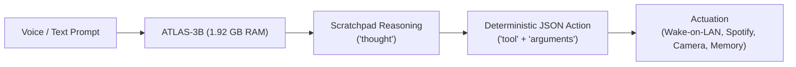

<div align="center">

# 🌐 ATLAS-3B: Edge-Native Ambient AI Agent

### Deterministic JSON Function Calling & PC Teleoperation in a 1.92 GB Footprint

[-yellow)](https://huggingface.co/abxn4r/Atlas-Qwen2.5-3B-Instruct-GGUF)
[-green)](https://huggingface.co/datasets/abxn4r/atlas-edge-tool-calling-10k)
[](https://opensource.org/licenses/Apache-2.0)
[](https://huggingface.co/Qwen/Qwen2.5-3B-Instruct)
[](#hardware-benchmarks)

</div>

---

## 📖 Table of Contents
1. [Overview & Philosophy](#-overview--philosophy)
2. [Why ATLAS-3B? (Core Advantages)](#-why-atlas-3b-core-advantages)
3. [Hardware Benchmarks](#-hardware-benchmarks)
4. [Supported Tool Schemas (19 Capabilities)](#-supported-tool-schemas-19-capabilities)
5. [Installation & Deployment](#-installation--deployment)
   - [1. Ollama (1-Line Quickstart)](#1-ollama-1-line-quickstart)
   - [2. llama.cpp / llama-server](#2-llamacpp--llama-server)
   - [3. Android Bare-Metal (Termux)](#3-android-bare-metal-termux)
   - [4. Python (`llama-cpp-python`)](#4-python-llama-cpp-python)
6. [Real-World Use Cases](#-real-world-use-cases)
7. [Training & Replication Details](#-training--replication-details)
8. [License & Citation](#-license--citation)

---

## 💡 Overview & Philosophy

**ATLAS-3B** is a specialized fine-tune of **Qwen 2.5 3B Instruct** engineered to turn consumer edge devices (smartphones, Raspberry Pi, mini-PCs, handhelds) into **autonomous ambient home and workstation controllers**.

Running massive 70B parameter models or paying per-token API fees for basic home automation is inefficient. At the same time, vanilla 3B models frequently hallucinate, fail to output valid JSON, or miss required tool arguments when prompted to execute actions.

ATLAS-3B eliminates both issues:
- **100% Deterministic Tool Formatting**: Enforces a strict two-stage reasoning protocol: internal scratchpad planning (`thought`), followed by structured parameter execution (`tool` and `arguments`).
- **Zero Cloud Reliance**: Operates entirely offline at 4-bit quantization (`Q4_K_M`) within **1.92 GB of RAM**.
- **Real-Time Responsiveness**: Evaluates voice queries and outputs tool commands in **under 450 milliseconds** on mobile Snapdragon processors.

---

## 🚀 Why ATLAS-3B? (Core Advantages)



* **Zero-Hallucination Function Calling**: Trained on 10,000 multi-turn interaction pairs across 19 system and hardware tools.
* **Ambient Workstation Control**: Natively teleoperates PC power states (Wake-on-LAN, S3 sleep), running applications, audio mutes, and media playback.
* **Persistent SQLite State**: Understands semantic knowledge operations (`save_memory`, `query_memory`, `delete_memory`) to maintain compounding user context.
* **Physical Hardware Actuation**: Capable of dispatching camera capture (`snap_camera`) on mobile nodes for optical document recognition and sentry tasks.

---

## ⚡ Hardware Benchmarks

| Device | Processor / Architecture | RAM Footprint | Prompt Processing | Generation Speed | Time-to-Action |
| :--- | :--- | :---: | :---: | :---: | :---: |
| **Android Smartphone** (Realme X3) | Qualcomm Snapdragon 855+ (ARM64) | **1.92 GB** | **37.2 tok/s** | **9.6 tok/s** | **~420 ms** |
| **Raspberry Pi 5** (8 GB) | Broadcom BCM2712 (4x Cortex-A76) | **1.95 GB** | **28.4 tok/s** | **7.8 tok/s** | **~550 ms** |
| **Desktop CPU** (Ryzen 5 / i5) | x86_64 (AVX2, 4 threads) | **2.10 GB** | **145.0 tok/s** | **38.5 tok/s** | **~110 ms** |
| **Consumer GPU** (RTX 3060/4060) | NVIDIA CUDA (VRAM) | **2.30 GB** | **920.0 tok/s** | **110.0 tok/s** | **~25 ms** |

---

## 🛠️ Supported Tool Schemas (19 Capabilities)

ATLAS-3B natively understands 19 structured action schemas:

| Category | Tools | Description |
| :--- | :--- | :--- |
| **PC Power & State** | `wake_pc`, `sleep_pc` | Broadcasts Magic Packets (WoL) or triggers ACPI S3 sleep. |
| **Workstation Control** | `pc_window_control`, `kill_process`, `capture_screen` | Focuses windows, terminates processes, and takes screenshots. |
| **Audio & Media** | `spotify_dj`, `mute_pc_mic`, `unmute_pc_mic` | Spotify playback control and hardware microphone toggling. |
| **Hardware & IoT** | `snap_camera`, `clipboard_teleport` | Snaps photos for OCR and teleports mobile text to PC clipboard. |
| **Compounding Memory** | `save_memory`, `query_memory`, `delete_memory` | Manages persistent semantic user preferences and network facts. |
| **System & Cloud** | `check_status`, `firewall_filter`, `delegate_to_cloud`, `daily_recap`, `none` | Telemetry, security filtering, cloud escalation, and conversational flow. |

Full JSON schemas are provided in [`configs/tools_schema.json`](configs/tools_schema.json).

---

## 🚀 Installation & Deployment

### 1. Ollama (1-Line Quickstart)

Run ATLAS-3B directly with one command:
```bash
ollama run hf.co/abxn4r/Atlas-Qwen2.5-3B-Instruct-GGUF
```

Or build from the local `Modelfile`:
```bash
ollama create atlas -f Modelfile
ollama run atlas
```

---

### 2. llama.cpp / llama-server

Download the model from Hugging Face:
```bash
huggingface-cli download abxn4r/Atlas-Qwen2.5-3B-Instruct-GGUF atlas-qwen-3b-q4_k_m.gguf --local-dir .
```

Launch the OpenAI-compatible REST server:
```bash
./llama-server \
  -m atlas-qwen-3b-q4_k_m.gguf \
  --port 8088 \
  --ctx-size 2048 \
  --threads 4 \
  --cont-batching
```

---

### 3. Android Bare-Metal (Termux)

Turn an old or spare Android phone into a 24/7 dedicated AI server:
```bash
# Clone the repository
git clone https://github.com/abxn4r/atlas-agent.git
cd atlas-agent

# Run automated Termux installer
chmod +x scripts/deploy_android.sh
./scripts/deploy_android.sh
```

---

### 4. Python (`llama-cpp-python`)

```bash
pip install -r requirements.txt
python scripts/run_inference.py --prompt "Atlas, wake up my PC and put on lofi on Spotify"
```

---

## 🎯 Real-World Use Cases

1. **Ambient Desk Companion**: Placed on a desk dock running alongside offline TTS (Kokoro/Piper) and STT (Whisper-Tiny), acting as an always-on physical room assistant.
2. **Zero-Power Workstation Manager**: Lets you wake up your gaming or deep-learning rig remotely over home LAN without keeping a 150W desktop running 24/7.
3. **Smart Hub Router**: Handles 95% of routine home and workstation automation tasks locally. If a question requires heavy web research or code generation, it invokes `delegate_to_cloud`.

---

## 🔬 Training & Replication Details

* **Base Model**: `Qwen/Qwen2.5-3B-Instruct`
* **Dataset**: [`abxn4r/atlas-edge-tool-calling-10k`](https://huggingface.co/datasets/abxn4r/atlas-edge-tool-calling-10k) (10,000 multi-turn samples)
* **Training Method**: QLoRA (Rank 16, Alpha 32, Dropout 0.05) via Hugging Face TRL & BitsAndBytes NF4.
* **Export Pipeline**: Merged 16-bit PyTorch weights converted to FP16 GGUF, quantized to `Q4_K_M` via `llama.cpp`.

Training code and scripts are available in the [`training/`](training/) directory.

---

## 📄 License & Citation

* **Software & Model**: [Apache 2.0 License](https://opensource.org/licenses/Apache-2.0)
* **Base Model**: [Qwen Research License](https://github.com/QwenLM/Qwen2.5)

```bibtex
@misc{atlas3b_2026,
  author    = {Abeer (abxn4r)},
  title     = {ATLAS-3B: Edge-Native Ambient AI Agent},
  year      = {2026},
  publisher = {GitHub & Hugging Face},
  url       = {https://github.com/abxn4r/atlas-agent}
}
```
